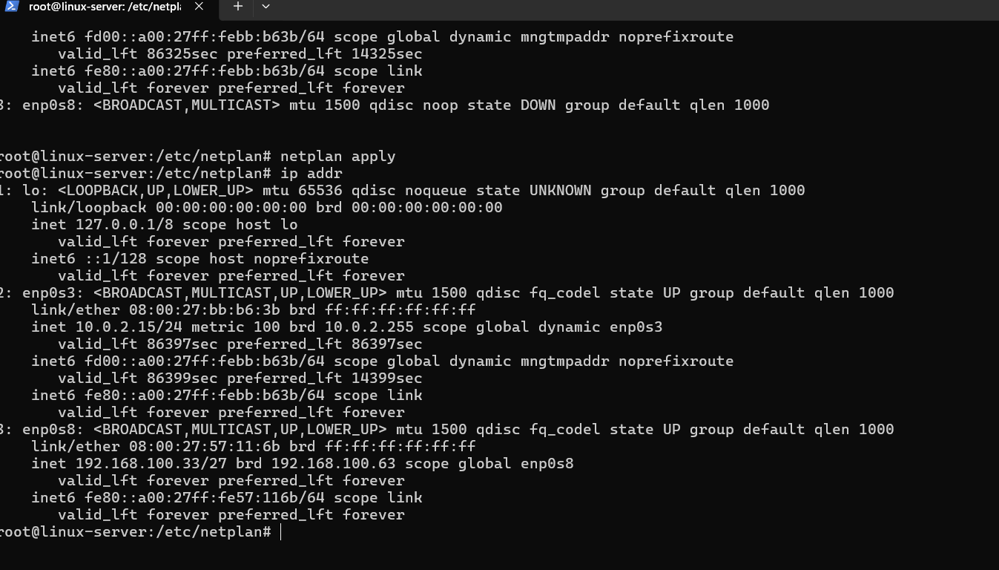
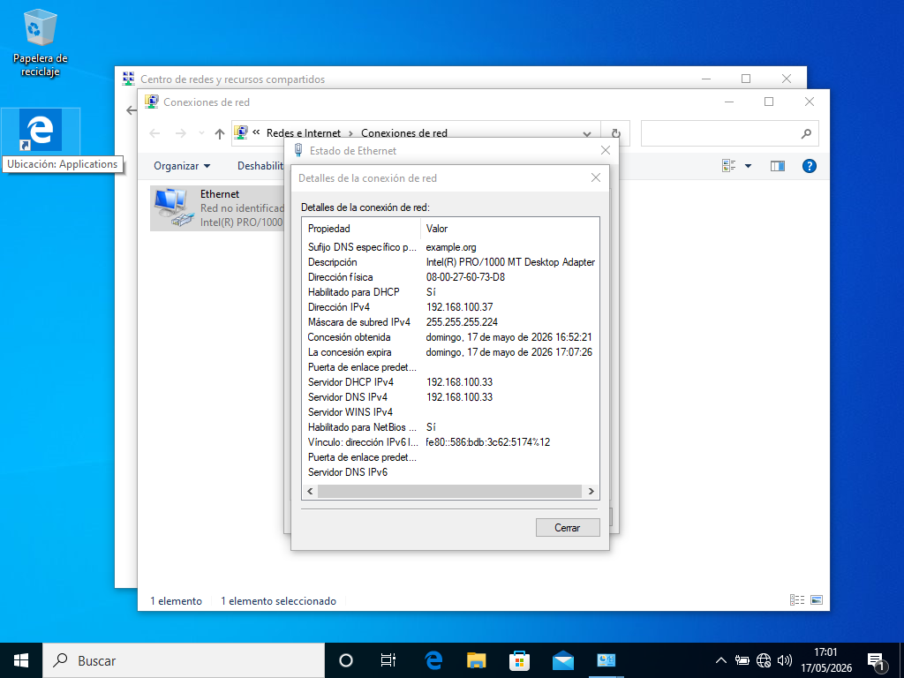
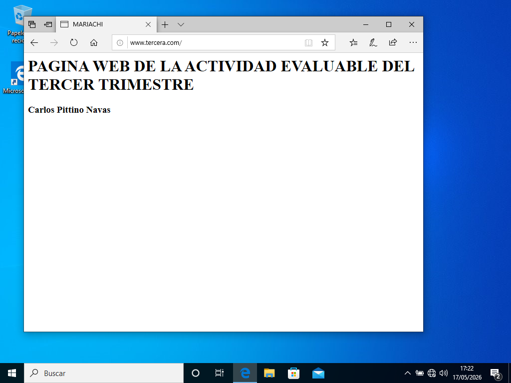
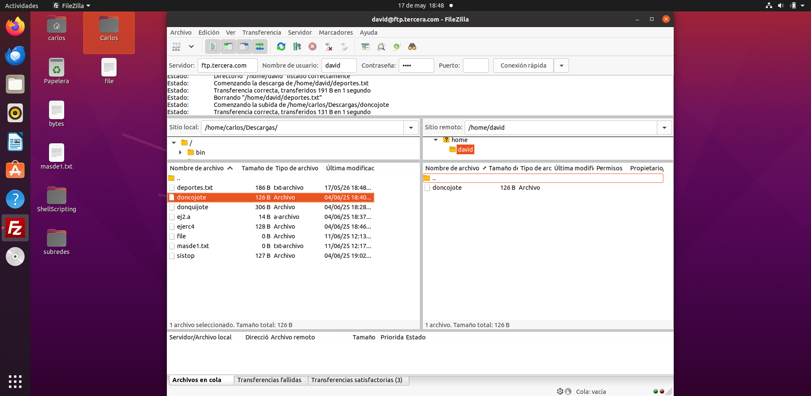

# Ubuntu Server Network Services Lab (DHCP, DNS, Web, FTP, Mail)

Lab from the Network Services and Internet module of the Higher Technical Degree in Network Computer Systems Administration (ASIR) at Universidad Europea, Madrid (2025/2026).

A single Ubuntu Server 24.04 machine provides DHCP, DNS, web, FTP and mail to a Windows client and an Ubuntu client in an isolated VirtualBox network. I first built and tested everything by hand (May 2026). Later I reviewed that configuration, fixed the problems I found and wrote a Bash script that sets up the whole server in one run.

## Network

The task was to split `192.168.100.0/24` into 8 subnets and use the second one.

```
                 NAT (internet, apt)
                        │
                     enp0s3 (DHCP)
              ┌─────────────────────┐
              │  Ubuntu Server 24.04│  DHCP · DNS · Apache · vsftpd · Postfix · Dovecot
              │   192.168.100.33/27 │
              └─────────────────────┘
                     enp0s8
                        │  internal network 192.168.100.32/27
            ┌───────────┴───────────┐
   Windows client               Ubuntu client
   192.168.100.37 (reserved)    192.168.100.40–62 (dynamic)
```

| # | Network | First host | Last host | Broadcast |
|---|---|---|---|---|
| 1 | 192.168.100.0/27 | .1 | .30 | .31 |
| **2** | **192.168.100.32/27** | **.33** | **.62** | **.63** |
| 3 | 192.168.100.64/27 | .65 | .94 | .95 |
| 4 | 192.168.100.96/27 | .97 | .126 | .127 |
| 5 | 192.168.100.128/27 | .129 | .158 | .159 |
| 6 | 192.168.100.160/27 | .161 | .190 | .191 |
| 7 | 192.168.100.192/27 | .193 | .222 | .223 |
| 8 | 192.168.100.224/27 | .225 | .254 | .255 |

Mask `255.255.255.224`: 3 bits borrowed from the host part give 8 subnets of 30 usable hosts each.

## Services

| Service | Software | Configuration |
|---|---|---|
| Network | netplan | Static `192.168.100.33/27` on the internal interface ([`60-lan.yaml`](config/netplan/60-lan.yaml)) |
| DHCP | ISC DHCP | Pool `.40–.62`, DNS and domain options, MAC reservation for the Windows client ([`dhcpd.conf`](config/dhcp/dhcpd.conf)) |
| DNS | BIND 9 | Authoritative zone `tercera.com` with A, CNAME, NS and MX records ([`db.tercera.com`](config/bind/db.tercera.com)) |
| Web | Apache 2 | Name-based virtual host for `tercera.com` / `www` / `web` ([`tercera.com.conf`](config/apache/tercera.com.conf)) |
| FTP | vsftpd | Users `david` and `angela`, each jailed in their own folder, TLS required ([`vsftpd.conf`](config/vsftpd/vsftpd.conf)) |
| Mail | Postfix + Dovecot | SMTP delivery to `user@tercera.com` in Maildir, IMAP for the clients ([`main.cf.settings`](config/postfix/main.cf.settings), [`local.conf`](config/dovecot/local.conf)) |
| Firewall | ufw | Only SSH and the ports of the services above are open |

## Automated setup

On a fresh Ubuntu Server 24.04 with two network adapters (NAT on `enp0s3`, internal network on `enp0s8`):

```bash
git clone https://github.com/Perle46/ubuntu-server-network-services.git
cd ubuntu-server-network-services
sudo bash scripts/setup.sh     # asks for a password for each FTP/mail user
sudo bash scripts/verify.sh    # checks every service
```

[`setup.sh`](scripts/setup.sh) installs the packages, copies each file from [`config/`](config/), checks the syntax before restarting each service (`dhcpd -t`, `named-checkzone`, `apache2ctl configtest`, `postfix check`) and enables the firewall. It stops at the first error.

[`verify.sh`](scripts/verify.sh) checks that every service is running, resolves the DNS records, requests the web page, confirms that the FTP server offers TLS and sends a test email to `david@tercera.com` to make sure it is delivered.

Passwords are never stored in the repository: the script asks for them when it creates the users.

## Results from the manual lab

**Server with a static address on the internal network**



**Windows client: address, DHCP server and DNS server assigned by the server**



**Windows client: `www.tercera.com` resolved by the DNS server and served by Apache**



**Ubuntu client: FileZilla upload, download and delete as user `david`**



## Issues found and fixed

When I reviewed my original configuration to automate it, I found several mistakes. The services seemed to work in the tests, but some of them would have caused problems in real use:

| Area | Problem in the manual lab | Fix |
|---|---|---|
| DNS | `web IN CNAME www.tercera.com` had no final dot, so BIND read it as `www.tercera.com.tercera.com` | Relative name `www` |
| DNS | The MX record was created for the name `w` instead of the domain, also without a final dot. Mail for `tercera.com` had no valid MX | `@ IN MX 10 mail.tercera.com.` |
| DNS | Zone serial not increased after editing the zone | Serial `3`; it must go up with every change |
| DHCP | The Windows reservation (`.37`) was inside the dynamic pool (`.35–.55`), so it could be leased to another client | Pool moved to `.40–.62` |
| DHCP | Clients received the default domain `example.org` | `option domain-name "tercera.com"` |
| FTP | With `chroot_local_user=YES` and `chroot_list_enable=YES`, the users in the list are **excluded** from the jail. FileZilla showed the full path `/home/david`, so the user was not jailed | Every user jailed in a root-owned `/home/<user>/ftp`, uploads in `ftp/files` |
| FTP | Passwords travelled in plain text (FileZilla: "server does not support FTP over TLS") | Explicit FTPS required |
| Mail | `mydestination` did not include `tercera.com` (and still listed `simulacro.es` from a previous exercise), so mail to `user@tercera.com` was not accepted as local | `mydestination` includes `$mydomain` |
| Web | The site was served from the default `/var/www/html` and the default site stayed enabled | Own `DocumentRoot`, default site disabled |

## Next steps

- Replace ISC DHCP, which reached end of life in 2022, with **Kea**.
- Add a reverse DNS zone for the `/27` subnet.
- Rewrite the setup as an **Ansible** playbook.

## Repository structure

```
config/
  netplan/   60-lan.yaml
  dhcp/      dhcpd.conf, isc-dhcp-server
  bind/      named.conf.local, db.tercera.com
  apache/    tercera.com.conf, index.html
  vsftpd/    vsftpd.conf
  postfix/   main.cf.settings
  dovecot/   local.conf
scripts/
  setup.sh   full server setup
  verify.sh  service checks
docs/images/ screenshots from the manual lab
```
